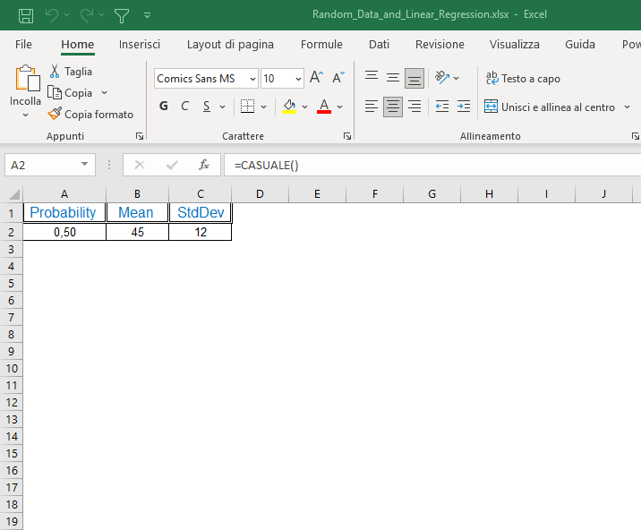
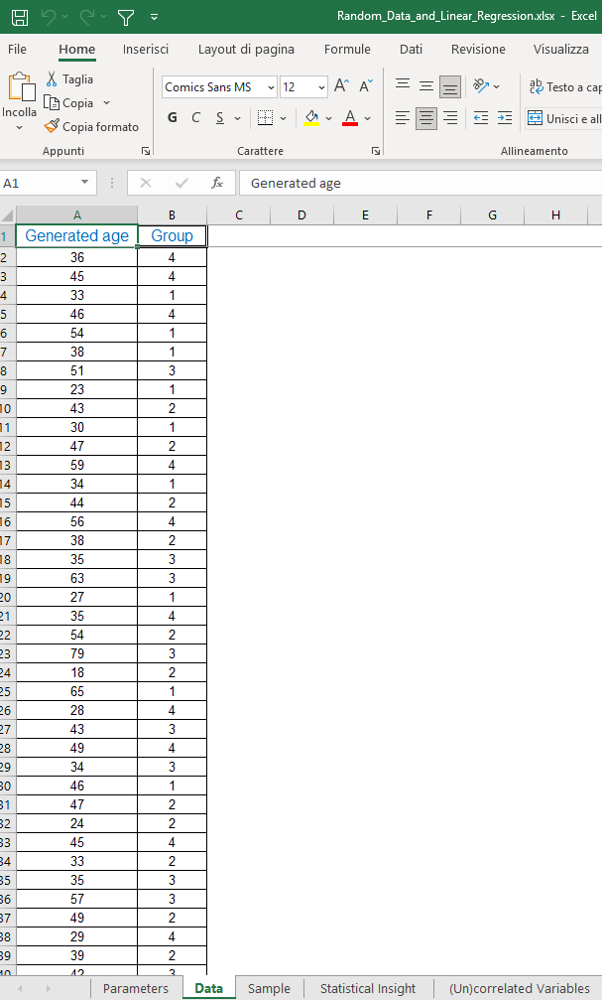
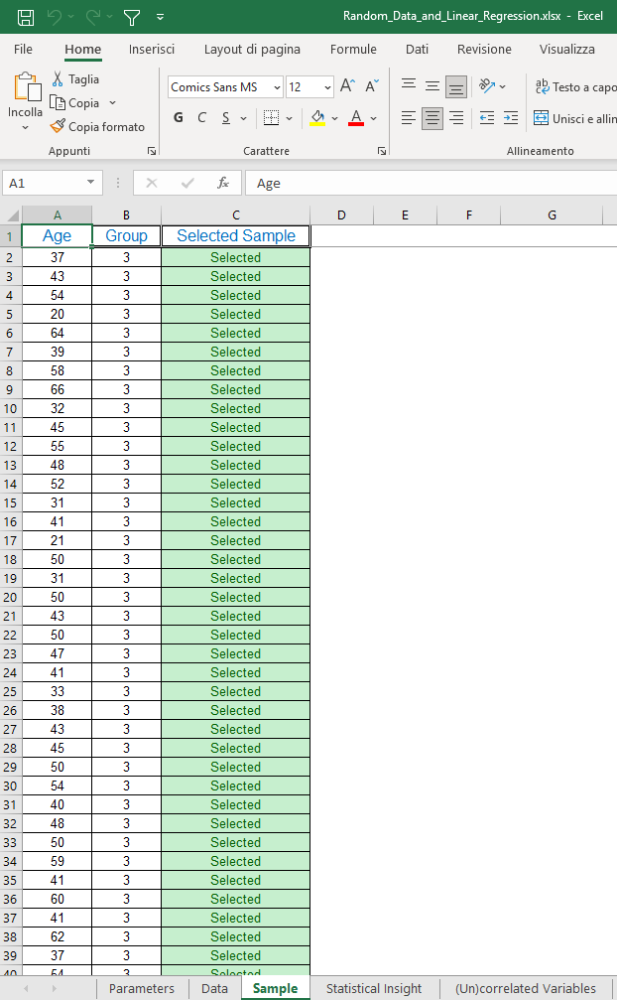
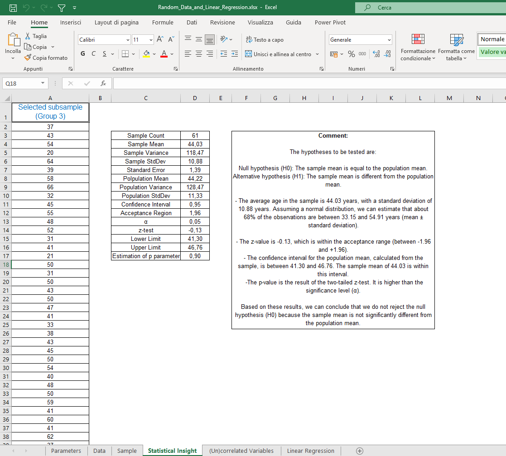
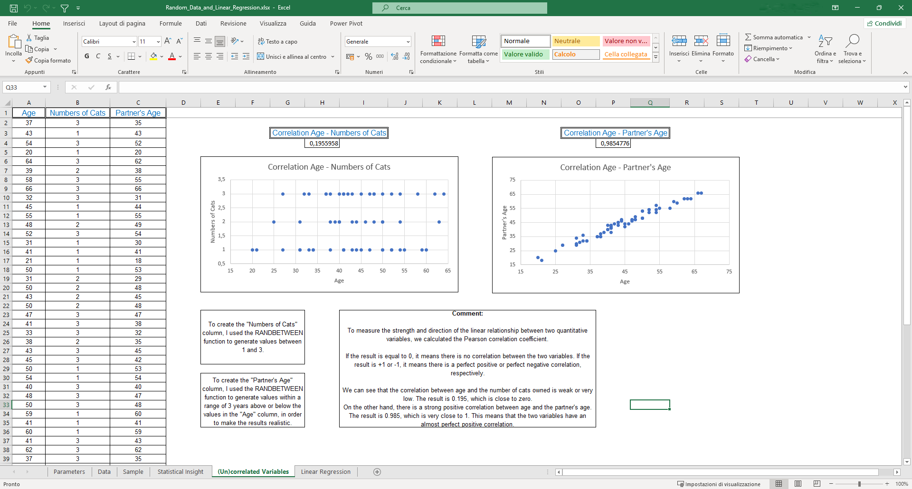
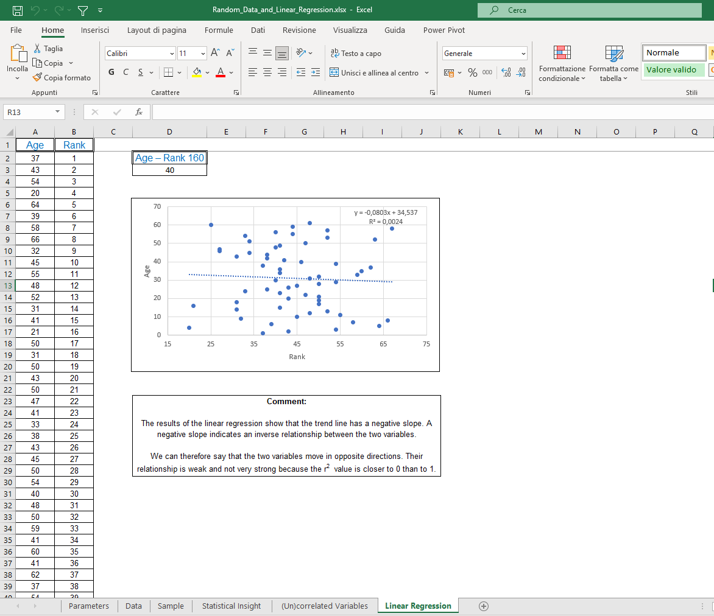

# 📊 Random Data and Linear Regression
## 📌 Project Overview
This project focuses on generating and analyzing a synthetic dataset using Microsoft Excel, with the aim of applying statistical concepts and analytical techniques to a simulated population.

The project involves generating normally distributed age data for a hypothetical population of 250 individuals, selecting random samples, performing statistical analyses, investigating correlations between variables, and applying linear regression.

The Excel workbook is structured into six dedicated worksheets, each focusing on a different stage of data generation, manipulation, and statistical analysis.

## 🗂️ Dataset
**Source:** Synthetic dataset generated using Microsoft Excel.

**Population:** 250 individuals.

**Main Variable:** Age.

**Distribution:** Normal distribution.

## 🎯 Project Objectives
The main objectives of the project were:

- Generate a synthetic dataset following a normal distribution.
- Apply random data generation techniques using customizable parameters.
- Manipulate and extract samples from the original dataset.
- Perform descriptive statistical analysis and hypothesis testing.
- Calculate confidence intervals and estimate population parameters.
- Investigate relationships between quantitative variables using correlation analysis.
- Apply linear regression to explore relationships between numerical variables.
- Develop practical skills in statistical interpretation and data-driven analysis.
  
## 🛠️ Tools & Techniques
- Microsoft Excel
- Random Data Generation
- Normal Distribution
- Statistical Sampling
- Data Manipulation
- Descriptive Statistics
- Mean and Standard Deviation
- Variance and Standard Error
- Hypothesis Testing (Z-test)
- Confidence Intervals
- Pearson Correlation Coefficient
- Scatter Plot Visualization
- Simple Linear Regression
- R-squared Analysis
  
## 📂 Project Structure
The Excel workbook is organized into six worksheets, covering data generation, sample selection, statistical analysis, correlation, and regression.

## 1. Parameters
This worksheet provides an interface for defining the parameters used to generate the synthetic dataset.

Key activities:

- **Probability:** Definition of the probability parameter used for data generation.
- **Mean:** Selection of the expected average age.
- **Standard Deviation:** Definition of the variability of the generated age values.

These parameters are used as inputs for generating a normally distributed dataset.

## 2. Data
This worksheet contains the generated dataset for the 250 individuals.

Key activities:

- Generation of random ages following a normal distribution.
- Assignment of individuals to four randomly generated groups (1–4).
- Organization of the generated observations into a structured dataset.

## 3. Sample
This worksheet focuses on selecting a subsample from the original dataset according to group membership.

Key activities:

- Extraction of age and group information from the original dataset.
- Selection of observations belonging to a specific group.
- Application of conditional Excel functions (IF) to filter the selected sample.

## 4. Statistical Insight
This worksheet performs statistical analysis on the selected sample to evaluate its characteristics and compare sample estimates with population parameters.

Key analytical activities:

- **Descriptive Statistics:** Calculation of sample size, mean, variance, and standard deviation.
- **Standard Error:** Measurement of the variability of the sample mean.
- **Hypothesis Testing:** Application of a two-tailed Z-test to compare the sample mean with the population mean.
- **Confidence Interval:** Calculation of the 95% confidence interval for the population mean.
- **Statistical Interpretation:** Evaluation of the test statistic, critical values, significance level, and p-value.

The worksheet also includes a written interpretation of the statistical results and their implications.

## 5. (Un)correlated Variables
This worksheet explores the relationships between individuals' ages and two randomly generated variables: the number of cats owned and the partner's age.

Key analytical activities:

- **Age and Number of Cats:** Generation of random values between 1 and 3 and calculation of the Pearson correlation coefficient.
- **Age and Partner's Age:** Generation of partner ages based on individuals' ages, with a random variation of ±3 years.
- **Correlation Analysis:** Calculation and interpretation of Pearson correlation coefficients.
- **Data Visualization:** Creation of scatter plots to visualize the relationships between variables.

The analysis highlights two different correlation patterns: a weak positive correlation between age and the number of cats (0.1956), and a very strong positive correlation between age and partner's age (0.9855).

## 6. Linear Regression
This worksheet applies simple linear regression to investigate the relationship between individuals' ages (Y) and their census ranking (X).

Key analytical activities:

- **Variable Selection:** Definition of age as the dependent variable (Y) and census ranking as the independent variable (X).
- **Linear Regression:** Calculation of the regression equation.
- **Scatter Plot Visualization:** Representation of observations and the fitted regression line.
- **Model Evaluation:** Interpretation of the regression coefficient and R-squared value.
- **Individual Analysis:** Identification of the age associated with participant number 160.

The regression model produced the following results:

- **Regression Equation:** y = -0.0803x + 34.537
- **R-squared:** 0.0024
- **Participant 160:** Age 40.
- 
The results indicate an almost negligible linear relationship between census ranking and individuals' ages. The very low R-squared value suggests that census ranking explains only 0.24% of the variability in age.

## 📊 Key Findings
The statistical analyses produced the following findings:

## 1. Statistical Insight
The selected sample consisted of 61 individuals, with the following results:

- **Sample Mean:** 44.03 years.
- **Population Mean:** 44.22 years.
- **Sample Standard Deviation:** 10.88 years.
- **Standard Error:** 1.39.
- **95% Confidence Interval:** 41.30–46.76 years.

A two-tailed Z-test was performed to compare the sample mean with the population mean.

- **Z-statistic:** -0.13.
- **Critical Values:** ±1.96.
- **Significance Level (α):** 0.05.
- **P-value:** 0.90.
- 
Since the test statistic falls within the acceptance region and the p-value exceeds the significance level, the null hypothesis cannot be rejected.

The analysis therefore provides insufficient evidence to conclude that the sample mean differs significantly from the population mean.

## 2. Correlation Analysis
The correlation analysis revealed two distinct relationships:

- **Age and Number of Cats:** Pearson correlation coefficient of 0.1956, indicating a weak positive linear relationship.
- **Age and Partner's Age:** Pearson correlation coefficient of 0.9855, indicating a very strong positive linear relationship.

The results demonstrate how correlation coefficients can be used to identify and compare the strength of relationships between quantitative variables.

## 3. Linear Regression
The regression analysis between age and census ranking produced:

- **Regression Equation:** y = -0.0803x + 34.537.
- **R-squared:** 0.0024.

The very low R-squared value indicates that census classification has almost no explanatory power on age variability.

Although the regression line has a slightly negative slope, the relationship between the two variables is practically negligible.

## 💡 Business Value
This project demonstrates how synthetic data and statistical techniques can be used to support analytical learning and experimentation.

Potential applications and benefits include:

- **Scenario Simulation:** Generate realistic synthetic datasets to test analytical approaches without having to use real personal information.
- **Statistical Skills Development:** Practicing sampling, descriptive statistics, hypothesis testing, and confidence interval calculations.
- **Relationship Analysis:** Understanding how correlation coefficients can identify relationships between quantitative variables.
- **Predictive Modeling:** Exploring the principles of linear regression and evaluating the explanatory power of a statistical model.
- **Data-Driven Decision-Making:** Developing the ability to interpret statistical results and draw evidence-based conclusions.

## 🎓 Conclusion
This project demonstrates how Microsoft Excel can be used as a practical tool for synthetic data generation and statistical analysis.

By combining normal distribution, random sampling, descriptive statistics, hypothesis testing, correlation analysis, and linear regression, the project explores different statistical techniques through a structured and interactive workbook.

The results highlight the importance of statistical inference when comparing sample and population parameters, as well as the role of correlation and regression in investigating relationships between quantitative variables.

Overall, this project get strength my practical skills in statistical analysis, data manipulation, hypothesis testing, and analytical interpretation, using Microsoft Excel.

## 📁 Repository Contents
- **[Random_Data_and_Linear_Regression.xlsx](Random_Data_and_Linear_Regression.xlsx):** Completed Excel workbook containing the six worksheets:
  - Parameters
  - Data
  - Sample
  - Statistical Insight
  - (Un)correlated Variables
  - Linear Regression
- **[images](images):** Folder containing screenshots of the six Excel workbook worksheets.
   
## 📸 Project Preview
## 1. Parameters
Input parameters used to generate the synthetic dataset.

## 2. Data and Sample
Generated dataset and sample selection process.

 

## 3. Statistical Insight
Descriptive statistics, hypothesis testing, and confidence interval analysis.

## 4. (Un)correlated Variables
Correlation analysis between age, number of cats, and partner's age.

## 5. Linear Regression
Scatter plot and linear regression model between age and census ranking.

## 📬 Contact
- **Silvia Venturini**
- [LinkedIn](https://www.linkedin.com/in/silvia-venturini92/)
- **Email:** silvia.venturini92@hotmail.com
